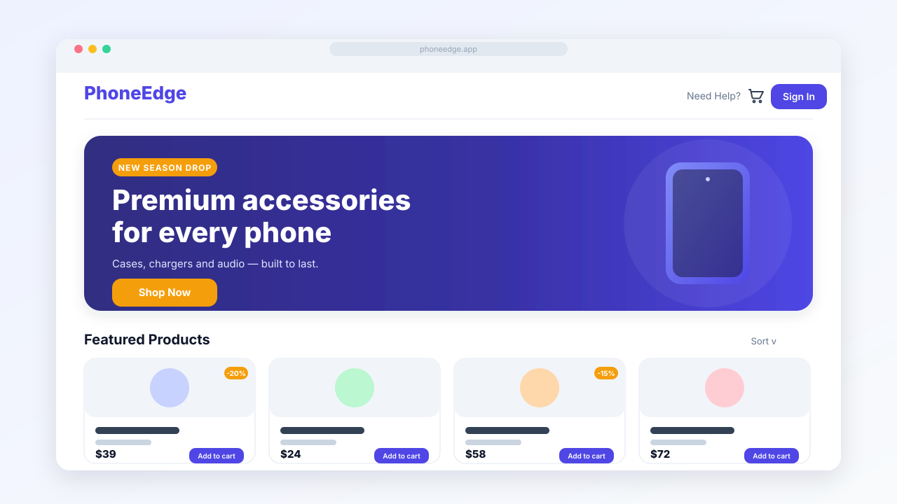

<div align="center">

# 🛒 PhoneEdge

**A modern phone-accessories storefront built with Vue 3, Vite, Pinia & Tailwind CSS.**

[](https://vuejs.org/)
[](https://vite.dev/)
[](https://tailwindcss.com/)
[](https://pinia.vuejs.org/)
[](https://firebase.google.com/)
[](https://workers.cloudflare.com/)



</div>

---

## ✨ Overview

PhoneEdge is a single-page e-commerce front end for selling phone accessories — cases,
chargers, audio and more. It showcases a clean, responsive UI, Firebase-backed
authentication, a Pinia-managed cart, and a complete browse → cart → checkout → order
flow. The codebase is organised into **feature modules** for easy maintenance and scaling.

## 🚀 Features

- **Responsive storefront** — hero **carousel**, promotion rails, category sidebar and a
  fluid product grid that adapts from mobile to ultra-wide screens.
- **Product catalogue** — search, sort (price / discount / rating) and category filtering.
- **Product detail** — image gallery, info panel, tags and customer reviews.
- **Shopping cart** — add / remove / update quantities, vouchers and a live order summary
  (state managed with **Pinia** + persisted to `localStorage`).
- **Checkout flow** — contact, shipping and payment forms → order confirmation.
- **Authentication** — email/password and Google sign-in via **Firebase Auth**, with
  route guards protecting authenticated pages.
- **Polished UX** — toast notifications, page transitions, reduced-motion support and
  accessible carousels (pause on hover/focus, keyboard-reachable controls).

## 🛠️ Tech Stack

| Area | Tools |
| --- | --- |
| Framework | [Vue 3](https://vuejs.org/) (Composition + Options API) |
| Build tool | [Vite 5](https://vite.dev/) |
| State | [Pinia](https://pinia.vuejs.org/) |
| Routing | [Vue Router 4](https://router.vuejs.org/) |
| Styling | [Tailwind CSS](https://tailwindcss.com/), Heroicons, Font Awesome |
| Auth | [Firebase Authentication](https://firebase.google.com/) |
| Testing | [Vitest](https://vitest.dev/) + Vue Test Utils |
| Deploy | [Cloudflare Workers](https://workers.cloudflare.com/) (static assets) |

## 📂 Project Structure

The app follows a **feature-module** architecture — each domain owns its views,
components, data and store.

```
src/
├── assets/                # Global styles (Tailwind entry, base CSS)
├── layouts/               # MainLayout (storefront) & AuthLayout
├── router/                # Router instance + per-module route files
│   └── routes/            # auth · home · product · cart · promotion
├── services/              # firebase.js (app initialisation)
├── shared/                # Cross-cutting UI & stores
│   ├── components/        # Navbar, Footer, HeroSection, RatingStar, …
│   └── store/             # toast.store.js
└── modules/
    ├── auth/views/        # SignInView, SignUpView
    ├── home/views/        # HomeView
    ├── product/           # views, components, data (products, categories)
    ├── cart/              # views (Cart, ShoppingCart, Checkout, OrderComplete) + store
    └── promotion/         # views, components (carousel, rails), data
```

## 🏁 Getting Started

### Prerequisites

- [Node.js](https://nodejs.org/) **18+**
- A [Firebase](https://firebase.google.com/) project with Authentication enabled
  (Email/Password and Google providers)

### 1. Install

```sh
npm install
```

### 2. Configure environment

Copy the example env file and fill in your Firebase web-app credentials:

```sh
cp .env.example .env
```

```dotenv
VITE_FIREBASE_API_KEY=
VITE_FIREBASE_AUTH_DOMAIN=
VITE_FIREBASE_PROJECT_ID=
VITE_FIREBASE_STORAGE_BUCKET=
VITE_FIREBASE_MESSAGING_SENDER_ID=
VITE_FIREBASE_APP_ID=
VITE_FIREBASE_MEASUREMENT_ID=
```

### 3. Run the dev server

```sh
npm run dev
```

The app runs at **http://localhost:5173** with hot-reload.

## 📜 Scripts

| Command | Description |
| --- | --- |
| `npm run dev` | Start the Vite dev server with hot-reload |
| `npm run build` | Build the production bundle to `dist/` |
| `npm run preview` | Preview the production build locally |
| `npm run test:unit` | Run unit tests with Vitest |

## ☁️ Deployment

The production build is served as static assets on **Cloudflare Workers**
(see `wrangler.toml`).

```sh
npm run build
npx wrangler deploy
```

## 🤝 Contributing

Contributions are welcome! Please open an issue to discuss significant changes first,
then submit a pull request.

## 📸 Updating the preview image

The image above (`docs/demo.svg`) is a UI mock-up. To replace it with a real screenshot,
run `npm run dev`, capture the home page, and save it as `docs/demo.png` — then update the
`` `src` near the top of this file.

## 📄 License

This project is currently **private** and has no license file. Add a `LICENSE`
(e.g. MIT) before distributing, and update this section accordingly.
